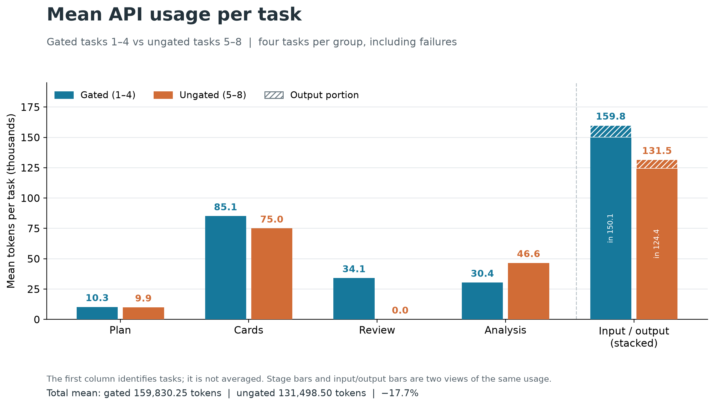
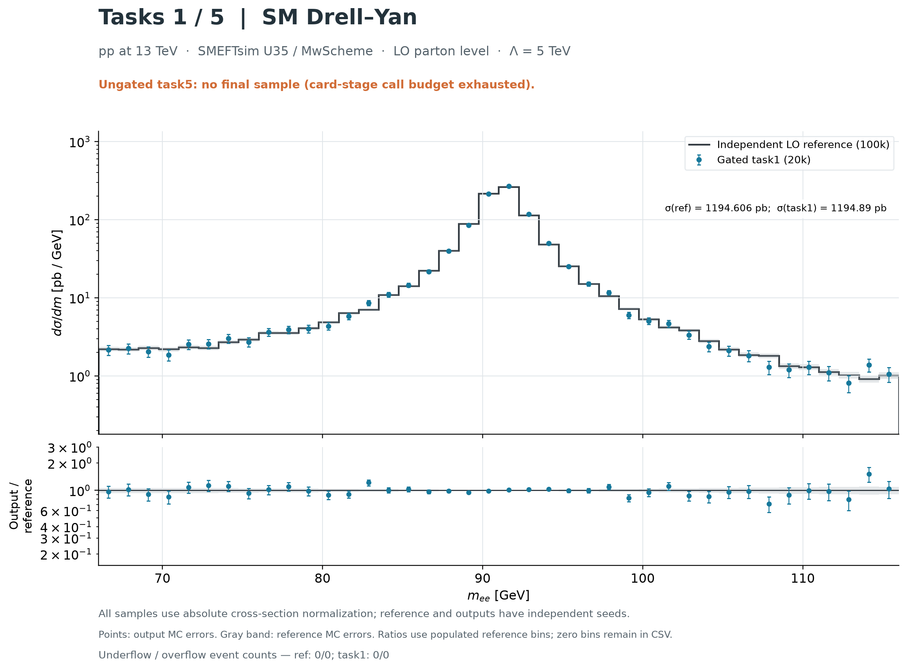
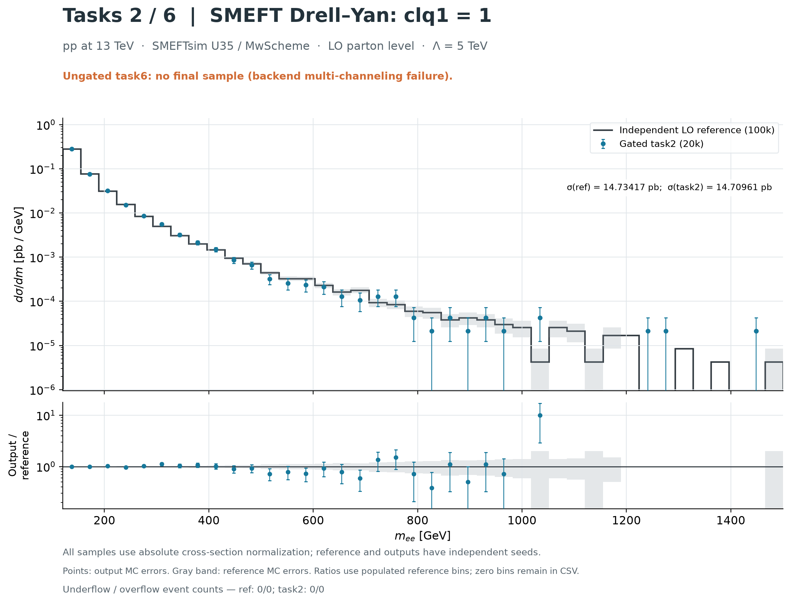
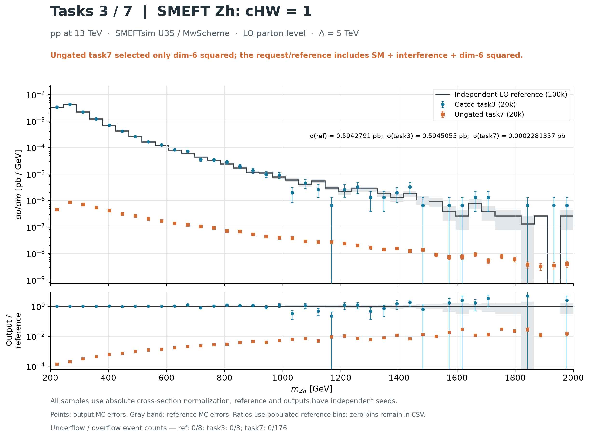
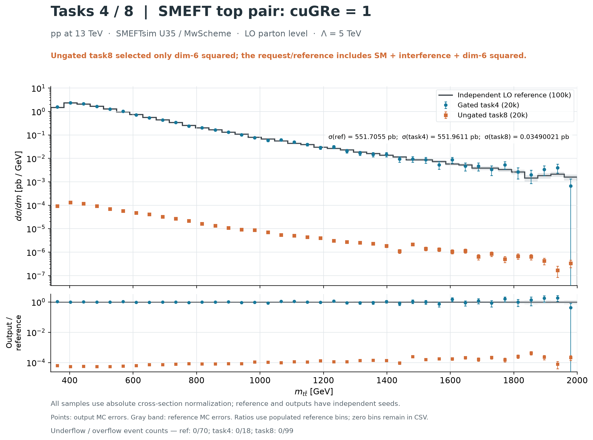

# Gate ablation pilot

[中文](README.zh-CN.md) · [Experiments](../README.md)

Four process/point pairs were run once with and once without automatic checks, targeting 20,000 events each. The gated runs completed 4/4 and matched the requested settings and independently recomputed numerical outputs. Ungated runs completed 2/4; those two used pure dimension-six-squared predictions instead of the requested combined prediction. Total API usage was 639,321 versus 525,994 tokens.

These are four exploratory pairs, with the historical task-specific budgets. The pilot exposes concrete failure modes; broader success-rate or cost claims require repeated, budget-matched trials. The SM task also contained an incorrect radiative-tail explanation despite matching cards and sample statistics.

- [Exact original requests](requests.json)
- [Per-task costs](data/task_costs.csv) and [group means](data/cost_group_means.csv)
- [Inputs, outputs and independent assessments](data/task_inputs_outputs.csv)
- [Histogram comparison data](data/comparison_data.json)

Each process has a separately configured 100,000-event LO reference with an independent seed. The comparisons use the recorded histogram values and uncertainties. In the task1/5 and task2/6 pairs, the failed ungated task has no output histogram.

