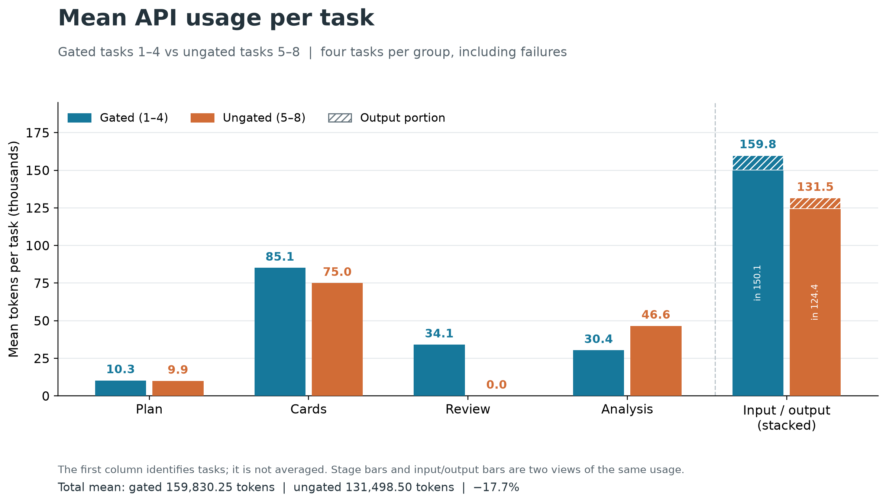
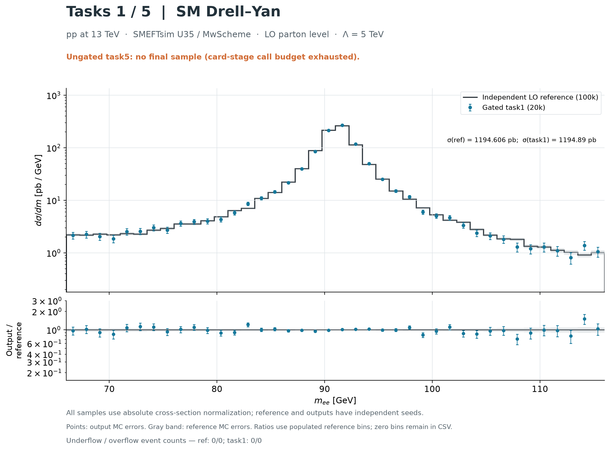
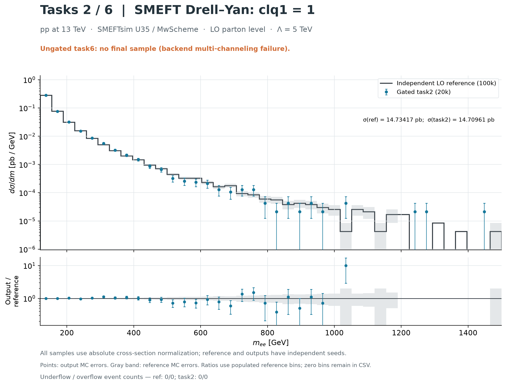
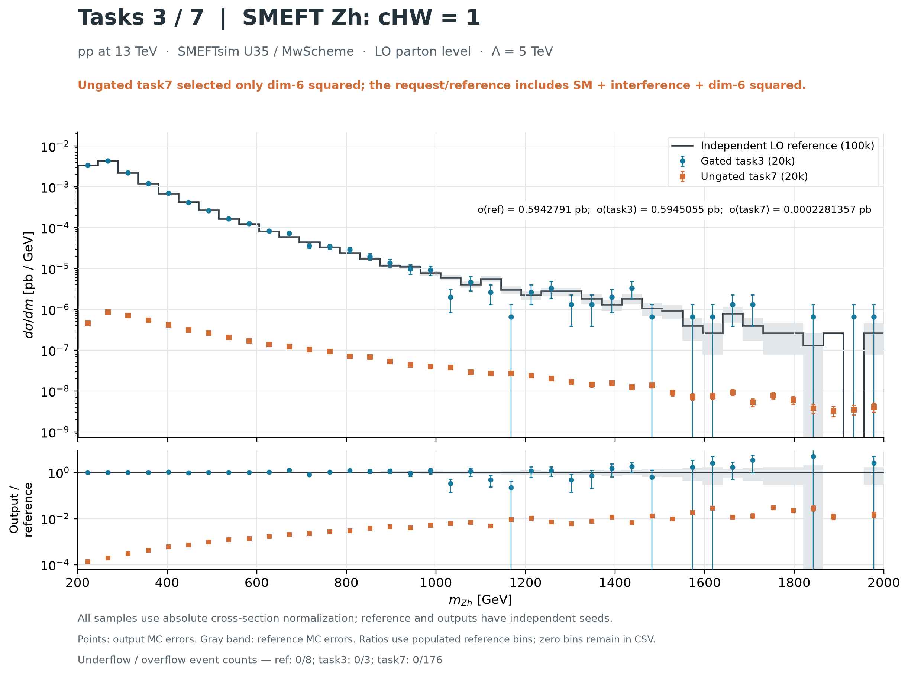
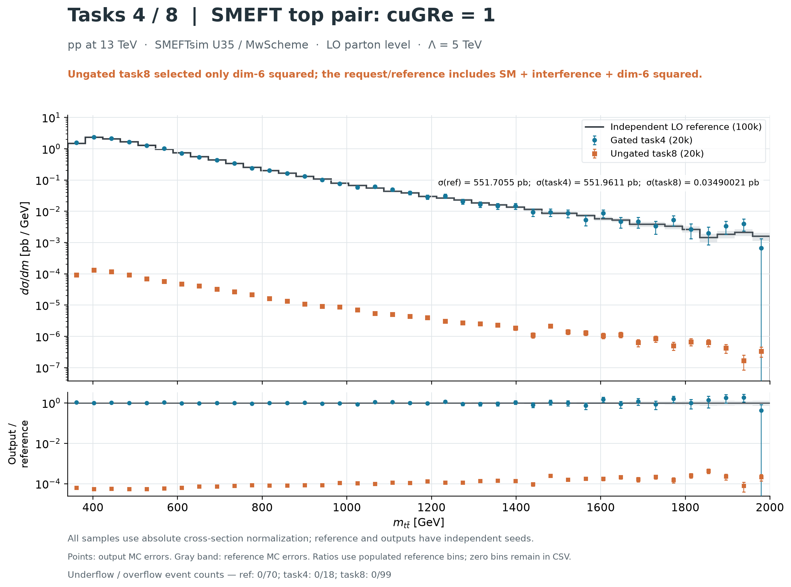

# 门控消融试验

[English](README.md) · [实验](../README.zh-CN.md)

四组过程与参数点分别运行一次带自动检查和不带检查的任务，每项请求 20,000 个事件。带检查组完成 4/4，符合请求设置和独立复算的数值结果；不带检查组完成 2/4，但两项均将请求的合并预测设置成纯维六平方贡献。总 API 用量分别为 639,321 和 525,994 token。

这是四组探索性配对，使用当时各任务的预算设置。它揭示了具体失败模式；要推断一般成功率或成本，需要重复、预算匹配的实验。SM 任务虽然卡片和样本统计吻合，说明中仍出现了错误的辐射尾解释。

- [原始请求](requests.json)
- [逐任务成本](data/task_costs.csv)与[组均值](data/cost_group_means.csv)
- [输入、输出与独立判断](data/task_inputs_outputs.csv)
- [直方图比较数据](data/comparison_data.json)

每个过程另有独立配卡、独立种子的 100,000 个 LO 参考事件。比较采用记录的直方图值和误差。task1/5 与 task2/6 中，失败的无门控任务没有输出直方图。

