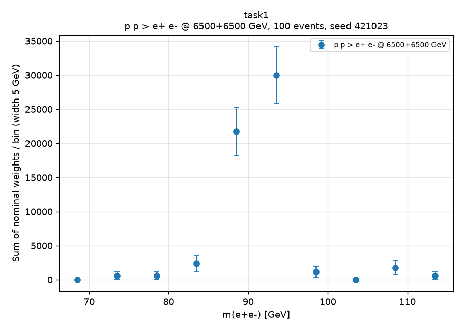

# Release portability checks

[中文](README.zh-CN.md) · [Experiments](../README.md) · [Deployment](../../docs/DEPLOYMENT.md)

On 2026-11-08, the release files were installed in a new Linux directory with fresh Python environments, models and backend. Setup also passed a repeated run. Both native Fortran and C++ probes compiled and executed.

| Check | Result |
|---|---|
| Regression suite in the new checkout | 293 passed |
| Official UFO runtime checks | 10/10 variants; 100 events each; 170 source files unchanged |
| Normal task API with `examples/request.txt` | Completed; 100 SM dilepton events, plot, table, program, summary and trajectory |
| Independent sample readback | Requested banner settings and all event cuts matched; per-bin sumw/sumw2 reproduced |
| HEPToolBench scorer replay | All six historical results reproduced exactly |

The API task used 33 model calls and 171,365 tokens, including 133,504 cached input tokens. Its request/card checks used the normal `needs_review` disposition path; the environment and sample checks succeeded. The independent readback then compared the generated sample and native banner with the example's physical settings.

[Machine-readable validation](validation.json) · [Histogram data](smoke_analysis.json)

Nikhef preparation includes a shared-path installation guide and HTCondor submit example. Actual site allocation, compiler modules and API connectivity are checked when deploying on the server.
