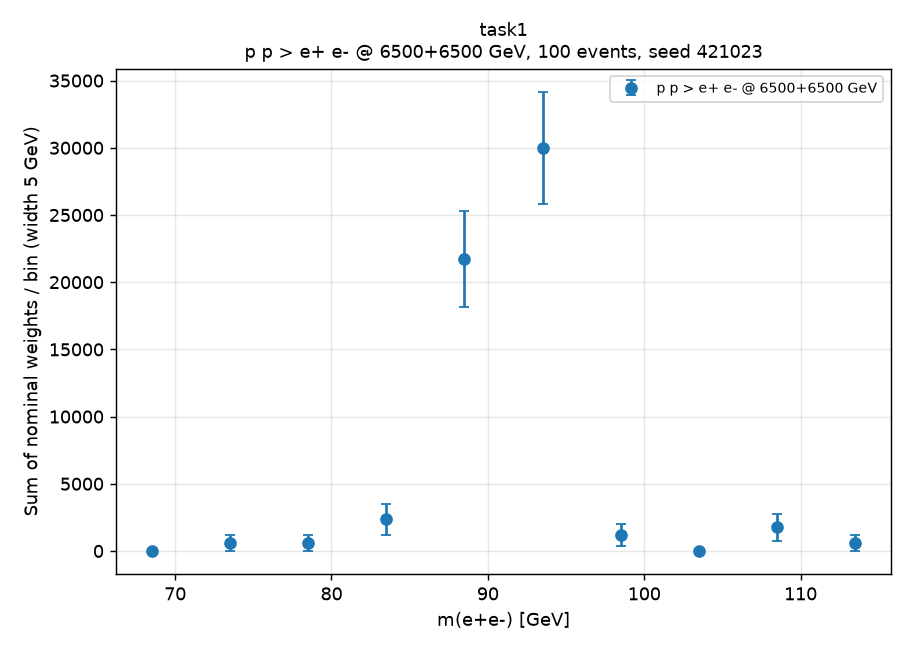

# 发布可迁移性检查

[English](README.md) · [实验](../README.zh-CN.md) · [部署](../../docs/DEPLOYMENT.zh-CN.md)

2026-11-08，将发布文件安装到一个新的 Linux 目录，重新创建 Python 环境、模型和后端；安装程序重复运行也通过。原生 Fortran 与 C++ 小程序均完成编译和执行。

| 检查 | 结果 |
|---|---|
| 新目录中的回归测试 | 293 项通过 |
| 官方 UFO 实际运行 | 10/10 个变体，各 100 事件；170 个源文件保持一致 |
| 正常任务 API 执行 `examples/request.txt` | 完成；100 个 SM 双轻子事件、图、表、程序、总结与轨迹 |
| 独立样本复读 | 原生 banner 符合请求，全部事件满足切选，逐 bin sumw/sumw2 复算一致 |
| HEPToolBench 评分重放 | 六轮历史结果完全复现 |

API 任务使用 33 次模型调用、171,365 token，其中缓存输入为 133,504 token。请求和卡片检查走正常的 `needs_review` 处置分支，环境和样本检查成功。随后独立复读生成样本与原生 banner，对照示例要求的物理设置。

[机器可读验证记录](validation.json) · [直方图数据](smoke_analysis.json)

Nikhef 准备包括共享路径安装说明与 HTCondor 提交示例；实际站点分配、编译器模块和 API 连通性在服务器部署时检查。
